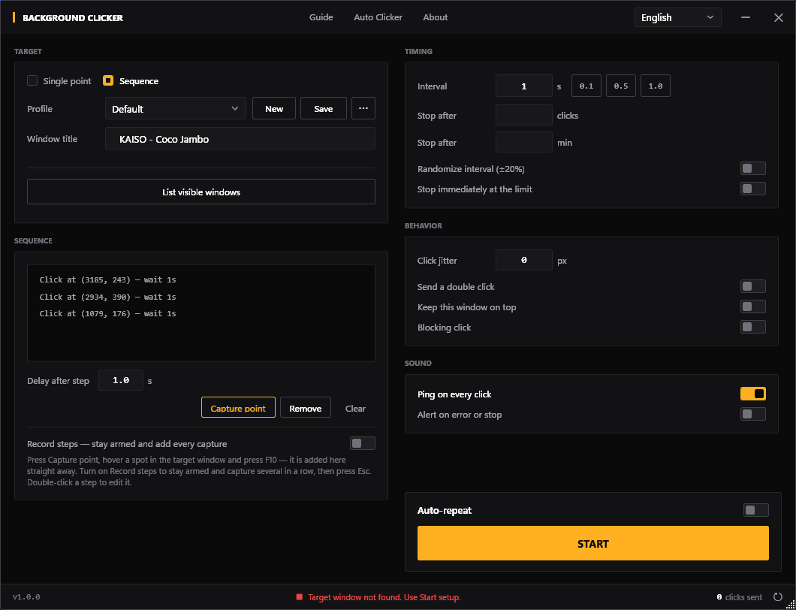
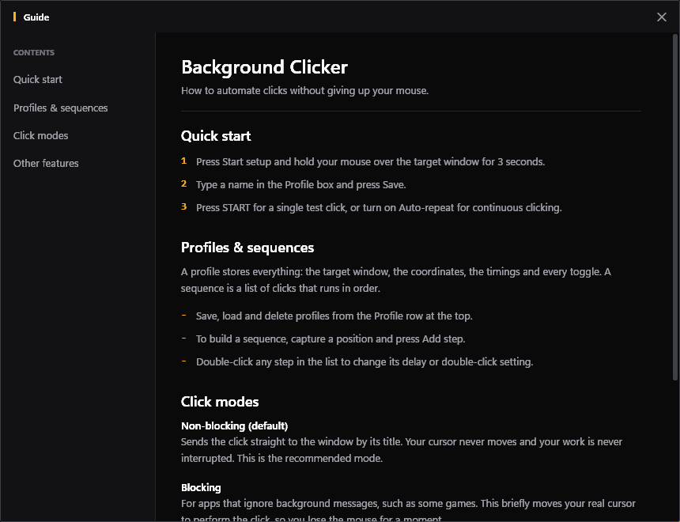
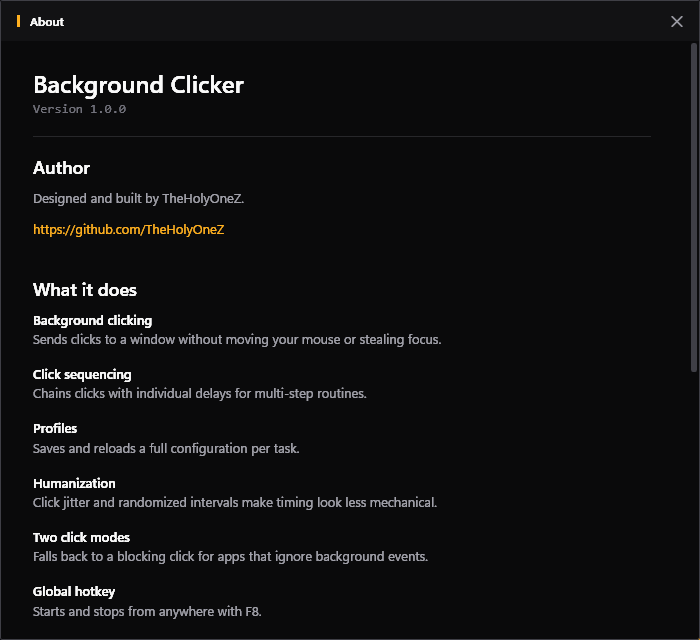

# Non-Blocking Window Clicker

**Version 1.0.0** · Windows · .NET Framework 4.7.2 · single portable `.exe`

Tired of automation tools that take over your mouse? This is a WPF application built for true background clicking. It sends commands directly to application windows, so you can keep working, gaming, or browsing while it runs.

> ### 🚀 Pre-compiled version available
> Download the ready-to-use `.exe` from the [**Releases**](https://github.com/TheHolyOneZ/BackgroundClickEmulationStudy/releases) page. One file, no installer, no dependencies, nothing to unzip.



---

## Table of Contents

- [What It Does](#what-it-does)
- [Requirements](#requirements)
- [Quick Start](#quick-start)
- [Target Modes](#target-modes)
- [Profiles](#profiles)
- [Building a Sequence](#building-a-sequence)
- [Timing and Humanization](#timing-and-humanization)
- [Click Modes](#click-modes)
- [Keyboard Reference](#keyboard-reference)
- [Auto Clicker Module](#auto-clicker-module)
- [Languages](#languages)
- [Where Your Data Lives](#where-your-data-lives)
- [Testing It](#testing-it)
- [Troubleshooting](#troubleshooting)
- [Building from Source](#building-from-source)
- [Project Structure](#project-structure)
- [Credits](#credits)

---

## What It Does

This tool automates mouse clicks at specific locations inside a target application window. You can set up a single repeating click or chain a multi-step sequence for more complex routines.

The key feature is that it works **in the background**. Unlike macro tools that hijack your cursor, it posts its commands straight to the target window's handle, leaving your physical mouse free the whole time.

### Core Features

| | |
|---|---|
| 🖱️ **True background clicks** | Non-blocking Win32 messages — the cursor never moves. |
| 💾 **Profile system** | Save and reload a full configuration per task, switchable from a dropdown. |
| 📜 **Click sequences** | Chain clicks, each owning its own window, coordinates, delay and double-click setting. |
| 🎯 **Point capture** | Arm setup, hover the spot you want, press **F10**. No returning to the app between points. |
| ⏺️ **Step recording** | Stay armed and turn every F10 into a sequence step — a ten-step routine is one arm and ten keypresses. |
| 🤖 **Humanization** | Click jitter and randomized intervals make the timing look less mechanical. |
| ⌨️ **Global hotkey** | Start and stop with **F8** from anywhere, even while minimized. |
| 🔒 **Blocking fallback** | For apps that ignore background messages, briefly uses the real cursor instead. |
| ⏱️ **Run limits** | Stop automatically after a number of clicks or minutes. |
| 🌍 **Ten languages** | Switch instantly, no restart. |

---

## Requirements

- **Windows** — the app uses the Win32 messaging API directly.
- **.NET Framework 4.7.2** or later. This ships with Windows 10 (1803+) and Windows 11, so on any current system there is nothing to install.

That is the whole list. There are no NuGet packages, no runtime to bundle, and no configuration files to place.

---

## Quick Start

1. **Launch the application.**
2. Open the program you want to click in.
3. Press **New**, give the profile a name, and press **Create**.
4. Leave the target on **Single point** and press **Start setup**.
5. Hover the exact spot you want in the target window and press **F10**. The window title and coordinates fill in automatically. **Esc** cancels.
6. Press **Save**.
7. Press **START**, or use the **F8** hotkey. Turn on **Auto-repeat** for continuous clicking.

For a multi-click routine, switch the target to **Sequence** — see [Building a Sequence](#building-a-sequence).

---

## Target Modes

The target card has two modes, and they never share fields. This is deliberate: one pair of coordinate boxes meaning two different things depending on hidden state is exactly what makes an app confusing.

### Single point

One target. The **X / Y** fields belong to it, and **Start setup** captures into them. The interval in the TIMING card controls how often it fires.

### Sequence

A list of clicks that runs in order. The X / Y fields **disappear entirely**, because every step carries its own window, coordinates and delay. Capture lives in the sequence card instead, as **Capture point**.

Each step's own *Delay after step* controls the pacing, so a list can have uneven timing — click, wait 5 s, click, wait 0.2 s, click.

---

## Profiles

A profile stores a complete setup: target mode, window title, coordinates, the whole sequence, every timing value and every toggle.

| Action | What it does |
|---|---|
| **New** | Creates a profile from default settings. The one you were on is left exactly as it was. |
| **Save** | Updates the selected profile in place. |
| **⋯ → Duplicate** | Copies the current setup, *including unsaved edits*, under a new name. |
| **⋯ → Rename** | Renames in place, without leaving a copy behind. |
| **⋯ → Delete** | Removes it, after confirming. There is no undo. |

Names must be unique, and the dialog tells you before it lets you continue. Switching profiles with unsaved edits offers to save them first, and backing out of that prompt leaves you on the profile you were already editing.

Pressing **START** with unsaved changes also offers to save first, so a run never silently uses settings that differ from what is on disk.

---

## Building a Sequence

Recording a sequence takes a single pass:

1. Choose **Sequence** at the top of the target card.
2. Turn on **Record steps**.
3. Press **Capture point**.
4. Hover a spot in the target window and press **F10**. It is appended to the list straight away and beeps to confirm.
5. Keep pressing **F10** at each point. Press **Esc** when you are done.

With *Record steps* off, capture ends after a single point — useful for appending one step to an existing list.

Double-click any step to edit its window title, coordinates, delay and double-click setting.

> **Prefer the mouse?** Holding the left button still for 3 seconds over a point captures it too. The press has to stay put — dragging cancels it, so a stray drag can never overwrite your coordinates.

---

## Timing and Humanization

| Setting | Effect |
|---|---|
| **Interval** | Seconds between clicks in single-point mode. Presets for 0.1 / 0.5 / 1.0 s sit beside the field. |
| **Randomize interval (±20%)** | Varies each wait by up to a fifth, so the rhythm is not perfectly even. |
| **Click jitter (px)** | Offsets each click by a random amount within the given radius, so it never lands on the exact same pixel. |
| **Stop after _n_ clicks** | Ends the run at a click count. |
| **Stop after _n_ minutes** | Ends the run at a time limit. |
| **Stop immediately at the limit** | Cuts the run off mid-sequence rather than finishing the current pass. |
| **Auto-repeat** | Off, **START** sends a single click or one pass of the sequence. On, it loops. |

---

## Click Modes

### Non-blocking (default)

Posts `WM_LBUTTONDOWN` / `WM_LBUTTONUP` straight to the target window's handle. **Your cursor never moves** and your work is never interrupted. This is the recommended mode and works with ordinary Win32 applications.

### Blocking

For applications that ignore background messages — many games, and every web browser. This briefly moves your **real** cursor to the target, clicks, and moves it back, so you lose the mouse for a moment.

> **Browsers always need Blocking mode.** Chrome, Edge and Firefox route input through their own pipeline and ignore posted window messages entirely. That is a browser architecture limitation, not a fault in this app.

---

## Keyboard Reference

| Key | Where | Action |
|---|---|---|
| **F8** | Anywhere, even minimized | Start / stop the clicker |
| **F10** | While capture is armed | Capture the point under the cursor |
| **Esc** | While capture is armed | Cancel capture, or finish recording |
| **F9** | Auto Clicker window | Start / stop (if the global hotkey is on) |
| **F10** | Auto Clicker window | Take the current cursor position |

F8 is ignored while a capture is armed, so a stray hotkey cannot start a run against a half-configured target.

---

## Auto Clicker Module

A separate, simpler tool reached from **Auto Clicker** in the title bar. Where the main window targets a specific window by title, this one just clicks wherever the cursor is — or at a fixed screen position.

- **Interval in milliseconds** rather than seconds, for high click rates.
- **Left, right or middle** mouse button, single or double.
- **Cursor position or fixed position**, with a *Pick current* button.
- **Randomize interval** and a live click counter.
- **F9** toggles, **F10** grabs the current position. The hotkey field is only editable while the global hotkey is on, so it can never advertise a binding that is not registered.

Maximum clicks per second depends on your system — typically 150 to 400.

---

## Languages

Ten languages are **compiled into the executable**. Download the `.exe`, run it, done.

| | | | | |
|---|---|---|---|---|
| English | Deutsch | Español | Français | Italiano |
| Polski | Português | Русский | Türkçe | 简体中文 |

Pick a language from the dropdown in the title bar. The change applies immediately — no restart — and is remembered for next time. On first run the app follows your Windows display language if it has a match, otherwise it starts in English.

> **A note on quality.** English and German are the reference translations. The other eight were produced with machine assistance and reviewed for length and terminology, but not by native speakers. Corrections are very welcome, and no rebuild is needed to test one.

### Adding or correcting a language

A `Lang` folder next to the executable is **optional**. Anything in it is added to the picker, and a file whose `_meta.code` matches a built-in language **replaces** it — which is how you can fix a shipped translation without touching the source.

1. Create a `Lang` folder next to `BackgroundClickerWpf.exe`.
2. Put a `<code>.json` in it — for example `Lang/nl.json`. Copy [`Lang/en.json`](Lang/en.json) from this repository as your starting point, or copy the language you want to correct.
3. Edit the `_meta` block at the top. `code` is the language code, `name` is the label shown in the dropdown:
   ```json
   "_meta": { "code": "nl", "name": "Nederlands" }
   ```
4. Translate the values on the right-hand side. **Leave the keys on the left alone**, and keep any `{0}`, `{1}` placeholders — they are replaced with real values at runtime.
5. Restart the app. Your language appears in the dropdown.

Anything you leave untranslated falls back to English rather than showing a blank, so a partial translation is perfectly usable. A file with a syntax error is skipped rather than crashing the app — if your language does not appear, check the JSON.

**Keep labels short.** The field labels in the left column render in a fixed 104-pixel gutter and will be ellipsised if they overflow. Around 15 characters is the practical ceiling.

Pull requests with new or corrected translations are welcome.

---

## Where Your Data Lives

Everything is under `%AppData%\BackgroundClickerWpf`:

| File | Contents |
|---|---|
| `profiles.xml` | Every saved profile, including full sequences. |
| `settings.xml` | Your chosen interface language. |

The application folder itself stays clean — nothing is written next to the `.exe`. To back up your setup, copy `profiles.xml`. To reset completely, delete the folder; it is recreated with a fresh default profile on next launch.

---

## Testing It

`test.html` in this repository is a measurement harness for verifying the clicker actually does what you configured.

Open it in a browser, choose how many buttons to spawn, and it places them at random non-overlapping positions. Every press is logged with:

- which button was hit, and a running hit count on the button itself
- **hold** — how long the button was held down (a synthesized click is near 0 ms, a human is 60–120 ms)
- **gap** — time since the previous click anywhere, which verifies your interval
- **same-btn** — time since the previous click on that same button
- whether it registered as a single or a double click

It also shows mean / min / max gap and a **jitter σ** figure, which is the direct way to confirm *Randomize interval* is doing what it claims. An order trail along the bottom shows the last several button IDs in click order, so you can confirm a recorded sequence really runs 1 → 2 → 3. Results export to CSV for longer unattended runs.

Because it runs in a browser, **use Blocking mode when testing against it** — see [Click Modes](#click-modes).

---

## Troubleshooting

**"Target window not found"**
The title has to match a window that is currently open. Use **List visible windows** to see exact titles, or capture the window again with setup — capturing also stores the window handle, which is more reliable than title matching.

**Clicks do nothing in a game or browser**
The target is ignoring posted messages. Turn on **Blocking click**. This is expected behaviour for browsers and many games.

**Clicks land in the wrong place**
Coordinates are relative to the target window's client area, not the screen. If the window has been moved since capture that is fine — but if it was a *different* window when you captured, capture the point again.

**The F8 hotkey does nothing**
Another application has already registered F8 globally. Close it, or use the START button.

**Nothing seems to happen**
Check the status bar at the bottom — it reports the reason for every refusal, and the coloured dot shows idle / running / error at a glance.

---

## Building from Source

Requires the **.NET Framework 4.7.2 developer pack** and MSBuild (Visual Studio 2022 or the standalone Build Tools).

```bash
msbuild BackgroundClicker.Wpf.csproj /p:Configuration=Release
```

The output lands in `bin\Release\BackgroundClickerWpf.exe`.

There are no NuGet dependencies. JSON parsing uses `System.Runtime.Serialization`, which ships with the framework, and the language files are embedded resources — so the build produces a **single self-contained executable** with nothing beside it.

---

## Project Structure

```
BackgroundClicker.Wpf.csproj   Old-style project; new files need an explicit entry

MainWindow.xaml(.cs)           Main interface, capture, profiles, click engine
AutoClickerWindow.xaml(.cs)    Standalone cursor auto-clicker
HelpWindow.xaml(.cs)           In-app guide with a section rail
CreditsWindow.xaml(.cs)        About screen; reads its version from the assembly
EditStepWindow.xaml(.cs)       Sequence step editor
PromptWindow.xaml(.cs)         Shared single-field prompt (new / duplicate / rename)
NotificationWindow.xaml(.cs)   Themed message box
WatermarkWindow.xaml(.cs)      Visible-window list

Themes/Palette.xaml            Colours, type scale, geometry tokens
Themes/Controls.xaml           Every control template, in one place

I18n/Loc.cs                    Language discovery and key lookup
I18n/JsonReader.cs             Dependency-free JSON reader
I18n/LocProvider.cs            Binding surface for live language switching
I18n/TrExtension.cs            The {i18n:T key} XAML markup extension
AppSettings.cs                 Language preference persistence

Lang/*.json                    Ten language files, embedded at build time
test.html                      Click measurement harness
```

### How the theme works

`App.xaml` merges `Themes/Palette.xaml` and `Themes/Controls.xaml`, and every window draws from those. No window defines its own colours. To restyle the whole application, change the tokens in `Palette.xaml`.

### How translation works

`{i18n:T some.key}` in XAML returns a live binding onto `LocProvider`, not a snapshot string. When the language changes, `Loc` raises an event and every bound string in every open window re-resolves at once — which is why switching needs no restart. Strings set from code go through `Loc.T(key)` and are re-applied where needed.

---

## Credits

Designed and built by **TheHolyOneZ** — [github.com/TheHolyOneZ](https://github.com/TheHolyOneZ)

Built with WPF and C#. It uses the Win32 messaging API to post mouse events directly to a window handle, which is what lets it click without taking control of your cursor.

---

## Gallery

### Main Interface


### Guide


### About

